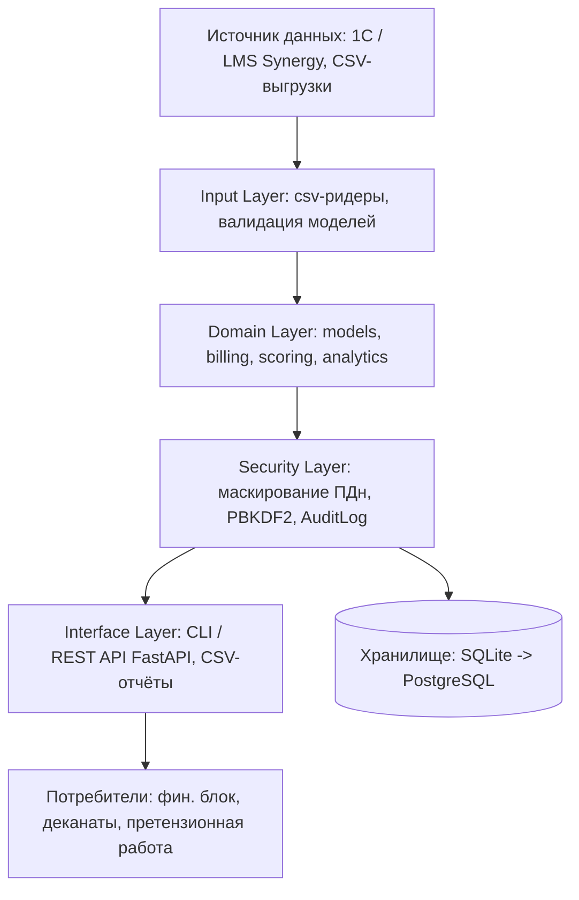

# Архитектура и план тестирования (этап «Проектирование»)

## 1. Общая схема

## 2. Слои и модули
| Слой | Модули | Ответственность |
|---|---|---|
| Ввод | `models.py` | DTO `Contract`/`Payment`, парсинг дат, `Decimal` для денег |
| Домен | `billing.py`, `scoring.py`, `analytics.py` | график, FIFO-распределение, пени, скоринг, IRR |
| Безопасность | `security.py` | обезличивание, хеширование, аудит с hash-цепочкой |
| Представление | `cli.py` | аргументы, вывод отчёта, сводка портфеля |

## 3. Ключевые проектные решения
* **`Decimal` вместо `float`** для денежных величин — исключаем ошибки округления (критично для финтеха).
* **Чистое ядро без I/O** — расчётные функции принимают данные и возвращают структуры, что
  делает их тривиально тестируемыми и переносимыми в сервис.
* **Пени как параметр, а не константа** — меняем ключевую ставку через аргумент, не через правку кода.
* **Объяснимый скоринг** вместо ML-чёрного ящика — требование заказчика и регуляторная подотчётность.
* **Hash-цепочка журнала** — компрометация одной записи обнаруживается проверкой `AuditLog.verify()`.

## 4. Технологический стек
Python 3.10+ (stdlib: `decimal`, `dataclasses`, `csv`, `hashlib`, `hmac`, `argparse`);
перспектива развития — FastAPI + SQLAlchemy + PostgreSQL + Redis, pytest + hypothesis,
Docker + docker-compose, GitHub Actions, Prometheus/Grafana для мониторинга.

## 5. План тестирования
| Вид | Инструмент | Предмет |
|---|---|---|
| Модульное (unit) | `unittest`, 24 проверки | арифметика графика, пени, скоринг, маскирование, аудит |
| Интеграционное | `python -m src.cli report` на тестовом датасете | сквозной путь CSV -> отчёт |
| Регрессионное | GitHub Actions (матрица Python 3.10-3.12) | нерушимость расчётов при правках |
| Нагрузочное | генератор 50 000 договоров + замеры `time` | соблюдение NFR-1 |
| Тест безопасности | проверка маскирования ПДн, сложности паролей, подмены лога | FR-6, NFR-5/6 |
| Приёмочное | чек-лист заказчика из `requirements.md` | подписание акта |

## 6. Развёртывание (этап «Реализация»)
1. Запуск в Docker-контейнере, конфигурация через переменные окружения.
2. Миграция хранилища SQLite -> PostgreSQL при подключении второго филиала.
3. Обучение пользователей: регламент формирования отчёта, расшифровка корзин просрочки и рейтинга.

## 7. Поддержка (этап «Поддержка и обслуживание»)
Ветвление `main`/`dev`, обязательный code review, semver, CHANGELOG,
мониторинг ошибок и ежемесячный пересмотр весов скоринга по фактическим возвратам долга.
